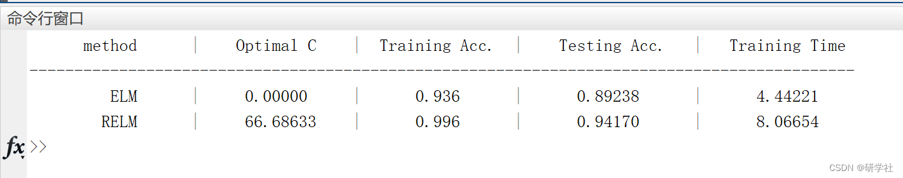
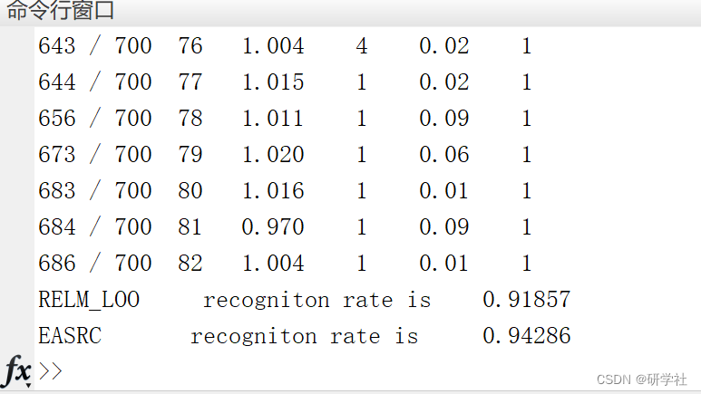
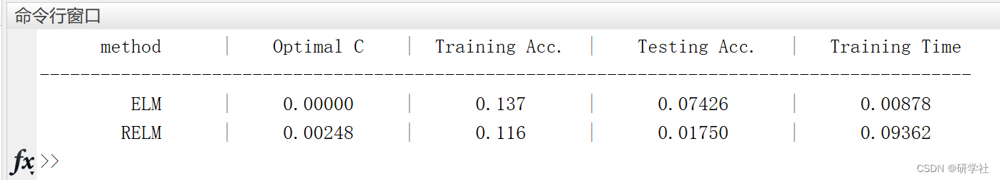

# Extreme Learning Machine and Adaptive Sparse Representation Algorithm (EA-SRC) (Matlab Code Implementation)

💥💥💞💞 Welcome to this blog❤️❤️💥💥
🏆 Bloggers' Advantages: 🌞🌞🌞 The content of the blog is assiduously thought-out and logically clear, for the convenience of readers.
⛳️ Motto: A journey of a thousand miles begins with a single step.
💥 1 Overview
📚 2 Editing Results
​Edit
​Edit
​Edit
Part of the code:
clear;clc; 
addpath(genpath('./.')); 
rng('default'); 
%%%%%%%%%-----load data-------------------------------------------------- 
[traindata,trainlabel,testdata,testlabel] = sinc_Huang; 
%%%%%%%-----------setting------------------------------------------------------------ 
nn.hiddensize  = 100;  
nn.inputsize   = size(traindata,1);  
nn.activefunction = 's';  
method      = {'ELM','RELM'};  
nn.type     = 'regression';  
%%%%%%%-----------initializzation----------------------------------------- 
nn        = elm_initialization(nn);
fprintf('   method   |  Optimal C  | Training Acc. |  Testing Acc. | Training Time \n');  
fprintf('--------------------------------------------------------------------------------------------\n');  
%--------ELM-----------------  
nn.method    = method{1};  
[nn, acc_train] = elm_train(traindata, trainlabel, nn);  
[nn1, acc_test] = elm_test(testdata, testlabel, nn);  
fprintf('   %6s   |  %.5f  |   %.3f   |   %.5f   |   %.5f   \n',nn.method,nn.C_opt,acc_train,acc_test,nn.time_train);  
%--------RELM-LOO-----------  
nn.method    = method{2};  
nn.C       = exp(-8:0.2:6);  
[nn, acc_train] = elm_train(traindata, trainlabel, nn);  
[nn2, acc_test] = elm_test(testdata, testlabel, nn);  
fprintf('   %6s   |  %.5f  |   %.3f   |   %.5f   |   %.5f   \n',nn.method,nn.C_opt,acc_train,acc_test,nn.time_train);  
🎉3 References  
🌈4 Matlab Code Implementation

## Images

<!-- PAYMENT_BLOCK -->

## Get this dataset

- Payment link (Stripe): [Buy now](https://buy.stripe.com/3cs8yP7sY87d0vu9AB)
- Payment QR code: 

<!-- /PAYMENT_BLOCK -->
